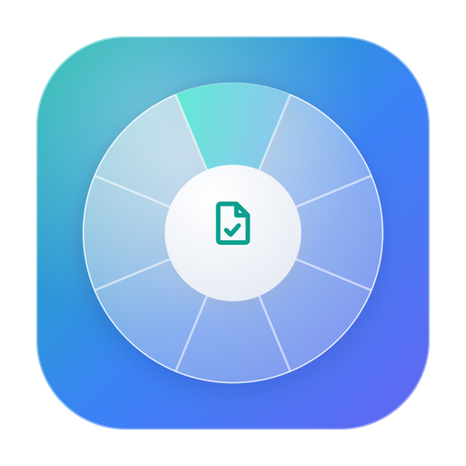
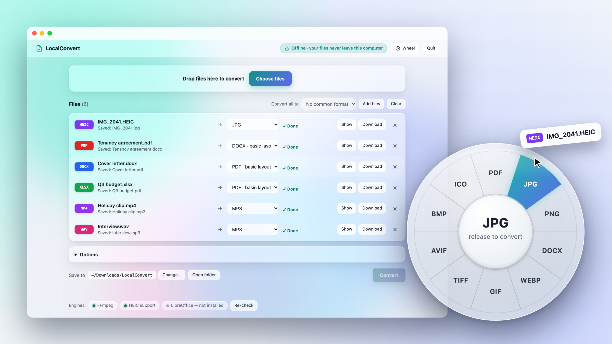
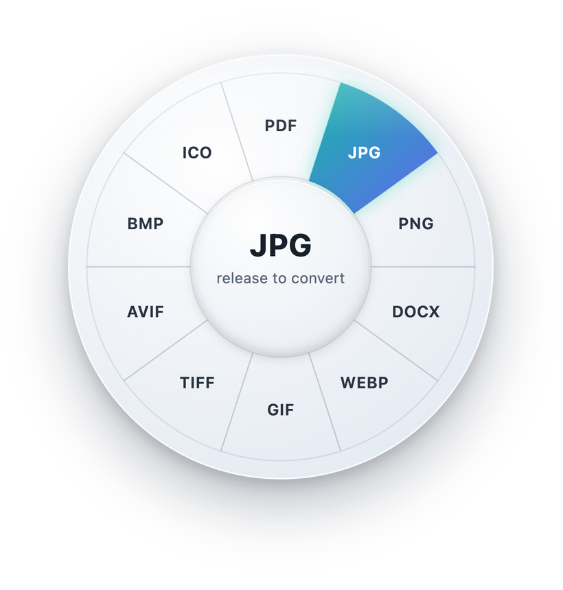
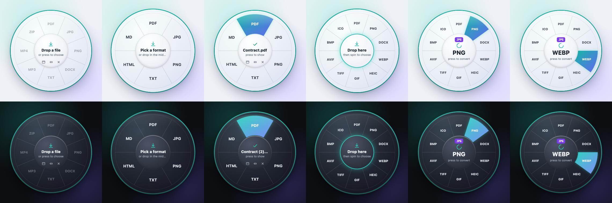
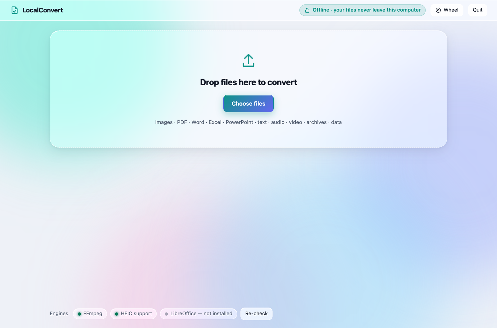
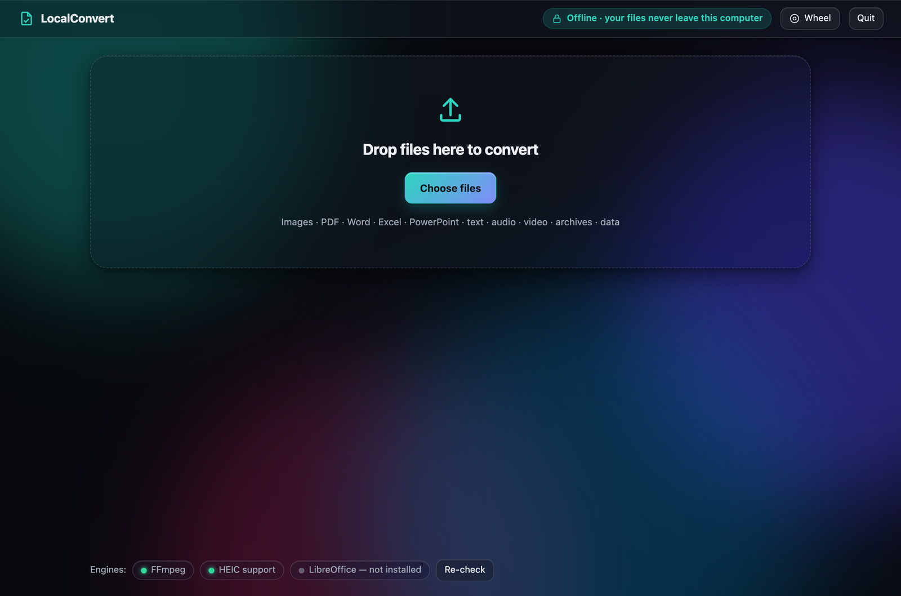

<div align="center">



# LocalConvert

**Convert any file without uploading it. Free, open source, and fully offline, with a click wheel.**

[](https://github.com/app-dialect/LocalConvert/releases)
[](https://github.com/app-dialect/LocalConvert/releases)
[](https://github.com/app-dialect/LocalConvert/stargazers)
[](https://github.com/app-dialect/LocalConvert/actions/workflows/ci.yml)


[](LICENSE)


[**⬇️ Download the beta**](https://github.com/app-dialect/LocalConvert/releases) · [Formats](#-what-it-converts) · [Click wheel](#-the-click-wheel) · [Privacy](#-how-your-files-stay-private) · [Contribute](#-contributing)

<br>

<picture>
  <source media="(prefers-color-scheme: dark)" srcset="docs/images/hero-dark.png">
  
</picture>

</div>

<br>

Online converters ask you to upload the file first. That's fine for a meme, and much less fine for **your passport scan, a signed contract, medical records or a bank statement.**

**LocalConvert does the whole job on your own computer.** Drop a file in and pick a format. It never uploads anything, there's no account or watermark, and it **keeps working with Wi-Fi turned off.**

It also has a **click wheel**: a small round widget, modelled on the iPod, that floats over your other windows. Drag a file onto it, slide onto the format you want, let go, and it's converted.

> [!NOTE]
> **LocalConvert is in public beta.** It already handles everyday conversions well, but expect rough edges. [Report anything odd](https://github.com/app-dialect/LocalConvert/issues/new/choose), because every issue makes the next release better.

## ✨ Why LocalConvert

|  |  |
|---|---|
| 🔒 **Nothing leaves your computer** | No uploads, no account, no analytics. The app talks only to itself on `127.0.0.1`. [See exactly how.](#-how-your-files-stay-private) |
| 💿 **The click wheel** | A round widget that floats over your other windows. Drag a file on, glide to a format, release. [More below.](#-the-click-wheel) |
| 🧩 **90+ file types in one app** | Photos, PDFs, Word, Excel, PowerPoint, audio, video, archives, data and subtitles, without a separate tool for each. |
| 📱 **iPhone photos, sorted** | HEIC to JPG in one drop. **GPS location and camera details are removed by default.** |
| 📚 **Batch and combine** | Drop 100 files and convert them all at once, or merge photos, PDFs and documents into **one PDF**. |
| 🪟 **Glass UI, light and dark** | A frosted-glass interface that follows your system theme, and turns solid when *Reduce transparency* is on. |
| ✈️ **Works offline** | Turn off Wi-Fi and convert anything. FFmpeg is bundled, so audio and video work out of the box. |
| ⌨️ **Scriptable** | A full command line for automation: `localconvert convert *.heic --to jpg`. |
| 🆓 **Free and open source** | MIT licensed. No watermarks, no file-size limits, no daily caps. |

### Compared with online converters

|  | **LocalConvert** | Typical online converter |
|---|:---:|:---:|
| Your file is uploaded to someone else's server | **Never** | Always |
| Works without internet | ✅ | ❌ |
| Account, email or sign-in | None | Often |
| File-size limits and daily caps | None | Common on free plans |
| Watermarks and ads | None | Common |
| Photo location data removed | ✅ by default | Rarely |
| Batch convert and combine into one PDF | ✅ | Often paid |
| Price | Free | Freemium |

## 💿 The click wheel

<div align="center">
<picture>
  <source media="(prefers-color-scheme: dark)" srcset="docs/images/wheel-dark.png">
  
</picture>
</div>

A small round widget that floats on top of your other windows, modelled on the iPod click wheel:

- **Drag a file onto it.** The ring fills with every format that file can become, and the segment under your cursor lights up with a soft *click*. **Release on a format** to convert straight away.
- **Or drop it in the centre and spin.** Drag around the ring, scroll, or use the arrow keys, then **press the centre** to convert.
- **When it's done,** press the centre to show the file in Finder or Explorer, or tap another format to convert the same file again.
- Right-click the centre to clear. Drag the rim to move the widget. The small buttons open the full app, toggle the click sound, or close the wheel.

Open it with the **Wheel** button in the app, run `python -m localconvert --widget`, or double-click `Start LocalConvert Wheel (Mac).command` / `(Windows).bat`.



## 🧩 What it converts

| From | To |
|---|---|
| **Images**: JPG, PNG, WebP, HEIC (iPhone), AVIF, GIF, BMP, TIFF, ICO, PSD, TGA… | Any of JPG, PNG, WebP, HEIC, AVIF, GIF, BMP, TIFF, ICO, **PDF**, Word |
| **PDF** | PNG/JPG/WebP/TIFF (one image per page), Word, text, HTML, Markdown |
| **Word and text**: DOCX, TXT, Markdown, HTML, EPUB, PPTX, source code and logs | **PDF**, Word, HTML, Markdown, text, **PNG/JPG** |
| **Spreadsheets and data**: XLSX, XLS, CSV, TSV, JSON, YAML | Excel, CSV, TSV, JSON, YAML, PDF, HTML, Markdown, Word |
| **Audio**: MP3, WAV, M4A, AAC, FLAC, OGG, Opus, AIFF, WMA | Any of MP3, WAV, M4A, AAC, FLAC, OGG, Opus, AIFF |
| **Video**: MP4, MOV, MKV, AVI, WebM, WMV, FLV, MPG, 3GP | MP4, MOV, MKV, AVI, WebM, **GIF**, or **extract the audio** (MP3, …) |
| **Archives**: ZIP, TAR, TAR.GZ, TAR.BZ2, TAR.XZ | Any of the other archive formats |
| **Subtitles**: SRT ↔ VTT | |
| **With LibreOffice installed** (optional, free): DOC, DOCX, ODT, RTF, Pages, XLS(X), ODS, Numbers, PPT(X), ODP, Keynote | PDF with the **exact original layout**, plus DOC↔DOCX, XLS↔XLSX, PPT↔PPTX, ODF formats, EPUB |

Run `python -m localconvert formats` to see every supported pair. Targets marked `*` keep the content (text, headings, lists, tables, images) but not the exact page layout. Install LibreOffice if you need pixel-perfect Office to PDF.

**Also built in:**
- **Combine** several images, PDFs and documents into **one PDF**, for example to turn phone scans of a document into a single file.
- **Batch** conversion: drop 100 files and pick one target with *Convert all to*.
- **Photo privacy**: EXIF data (GPS location, camera) is **removed by default** when converting photos.
- **Command line** for automation and scripting.

## 🪟 Glass UI, light and dark

<table>
<tr>
<td></td>
<td></td>
</tr>
</table>

Frosted-glass panels over a soft colour field that follows your system's light or dark mode. If *Reduce transparency* is on, the panels become solid.

## ⬇️ Install

**Download the app (no Python needed):** grab the zip for your computer from the [**latest release**](https://github.com/app-dialect/LocalConvert/releases):

| Your computer | Download |
|---|---|
| Mac with Apple Silicon (M1 and newer) | `LocalConvert-macOS-arm64.zip` |
| Mac with an Intel chip | `LocalConvert-macOS-x86_64.zip` |
| Windows 10 / 11 | `LocalConvert-Windows.zip` |

Unzip it and open **LocalConvert**.
- **macOS:** the app isn't notarized yet, so the first time, right-click it and choose **Open** (or *System Settings ▸ Privacy & Security ▸ Open Anyway*).
- **Windows:** if SmartScreen warns you, click **More info**, then **Run anyway**.

**Run from source:**
- macOS: double-click `Start LocalConvert (Mac).command`
- Windows: double-click `Start LocalConvert (Windows).bat`

The first run installs the Python libraries (this needs internet once, and only downloads software). After that the app runs fully offline. You need Python 3.9 or newer.

**Command line:**
```bash
python -m localconvert                                   # open the app
python -m localconvert --widget                          # open just the click wheel
python -m localconvert convert report.docx --to pdf      # → ~/Downloads/LocalConvert/
python -m localconvert convert *.jpg --to pdf --combine --name "Scans" -o ~/Desktop
python -m localconvert convert video.mov --to mp3
python -m localconvert formats docx                      # what can a .docx become?
python -m localconvert doctor                            # which engines are installed
```

## 🔒 How your files stay private

The interface is a web page, but it's served by the app itself and talks only to the app, never to the internet:

| Protection | Where |
|---|---|
| The server listens on `127.0.0.1` only, so other devices on your network can't reach it | `server.py`, `LocalServer` |
| A random secret token is created at each launch and required on every request, so other websites open in your browser can't use the app | `server.py`, `guard()` |
| The `Host` header is checked to block DNS-rebinding attacks | `server.py`, `guard()` |
| A strict Content-Security-Policy stops the page from loading anything external (no CDNs, fonts or analytics) | `server.py`, `CSP` |
| Remote images referenced in HTML/Markdown are **never fetched** | `docmodel.py`, `_image` |
| Files added by drag-and-drop are copied to a temporary folder that's deleted on exit. Files picked with **Choose files** are read where they are and not copied | `server.py` |
| Request URLs are not logged | `server.py`, `QuietHandler` |

**What leaves your computer: nothing.** There are no analytics, crash reports, update checks or accounts. To check this yourself, turn off Wi-Fi and convert something.

## 🛠 Project layout

```
localconvert/
  __main__.py          CLI + app launcher (native window via pywebview, or browser)
  server.py            local web server and API
  core/
    registry.py        every conversion registers here: (source, target, engine, priority)
    engines.py         detects FFmpeg / LibreOffice / HEIC support
    jobs.py            runs conversions (background queue for the UI)
  converters/
    images.py          Pillow: image ↔ image, image → PDF
    pdf.py             pypdfium2: PDF → images; pypdf: merging
    docmodel.py        format-neutral document model + HTML reader
    documents.py       readers (txt/md/html/docx/pdf/pptx/epub/code) & writers (pdf/docx/html/md/txt/images)
    office.py          LibreOffice (optional) for exact-layout Office conversions
    data.py            spreadsheets, CSV, JSON, YAML
    media.py           FFmpeg audio/video (with progress)
    archives.py        zip/tar repacking (path-traversal safe)
    subtitles.py       SRT ↔ VTT
  web/                 the interface (plain HTML/CSS/JS, no external resources)
    index.html/app.js  main window (glass UI)
    widget.*           click-wheel widget
    common.js          shared token/API/upload helpers
assets/                app icons (.icns, .ico)
tests/                 generates a sample of every format and converts it to every target
```

**Adding a format:** write a function `(src_path, out_dir, target, options) -> [output paths]` and decorate it with `@register("Name", sources, targets, engine=...)`. The UI, CLI and tests pick it up automatically.

**Documents** go through a small intermediate model (`docmodel.Document`): with N readers and M writers you get N×M conversions. A new reader (say ODT) instantly converts to PDF, Word, HTML, Markdown, text and images.

## 📦 Building standalone apps

- **Automatically (recommended):** push a tag such as `v0.2.0-beta`. The **build** workflow builds Windows, macOS Apple Silicon and macOS Intel apps and publishes them as a GitHub release, with that version's section of [CHANGELOG.md](CHANGELOG.md) as the notes. You can also run it from the Actions tab to get the zips without releasing.
- **Locally:** `scripts/build.sh` (macOS) or `scripts\build-windows.bat` (Windows). PyInstaller can't cross-compile, so build each OS on that OS.

The app bundles FFmpeg, so audio and video work without a separate install. A build is about 115 MB.

## ⚠️ Known limitations

- Without LibreOffice, Word/PowerPoint/Excel → PDF keeps the content but not the exact layout (fonts, columns, headers/footers).
- PDF → Word extracts the text only. Scanned PDFs have no text and need OCR (planned).
- Right-to-left and complex scripts (Arabic, Devanagari shaping) aren't laid out correctly in generated PDFs. Use LibreOffice for those.
- SVG, RAW camera files and Apple Live Photos aren't supported yet.
- The click wheel's glass is drawn with gradients, because a transparent desktop window can't blur what's behind it.

## 🗺 Roadmap

- [x] Glass UI with light and dark themes
- [x] Click-wheel widget
- [ ] Signed and notarized builds (no more *Open Anyway*)
- [ ] Homebrew cask and winget package
- [ ] **PDF forms:** detect fields, fill them in and save, with optional flattening
- [ ] **PDF tools:** merge, split, reorder, rotate and delete pages; add text and signatures; true redaction; add or remove passwords
- [ ] **Image tools:** crop, resize, rotate, compress to a target size
- [ ] **OCR** for scanned PDFs and images (bundled Tesseract, still fully local)
- [ ] Rich-text editing for DOCX/MD/TXT using the existing document model
- [ ] Native macOS vibrancy behind the click wheel

Have an idea? [Request a feature or format](https://github.com/app-dialect/LocalConvert/issues/new/choose) or upvote one with a 👍.

## 🤝 Contributing

LocalConvert is built in the open and PRs are very welcome, from typo fixes to whole new formats.

1. **Fork** this repo and create a branch.
2. `python3 -m venv .venv && .venv/bin/pip install -r requirements-dev.txt`, then `.venv/bin/python run.py`.
3. Open a **pull request**. CI runs the tests on macOS and Windows automatically.

Start with **[CONTRIBUTING.md](CONTRIBUTING.md)** (including *Add a format in 3 steps*). Please follow our [Code of Conduct](CODE_OF_CONDUCT.md); security reports go through [SECURITY.md](SECURITY.md).

## ⭐ Like it?

If LocalConvert saved you from uploading something private, **star the repo**. It's the best way to help others find it. Share it with a friend who still emails themselves files to convert them.

[](https://star-history.com/#app-dialect/LocalConvert&Date)

## 📄 License

[MIT](LICENSE), free for personal and commercial use.

All bundled libraries use permissive licences (MIT/BSD/Apache/HPND), except the FFmpeg binary bundled by `imageio-ffmpeg`, which is GPL. That's fine for a free tool. For a paid closed-source product, switch to an LGPL FFmpeg build. LibreOffice (MPL) is never bundled; it's used only if you installed it. PyMuPDF and pdf2docx were avoided on purpose because they're AGPL/GPL.

<sub>LocalConvert is an independent open-source project and is not affiliated with Apple, Microsoft, Adobe or The Document Foundation. iPod is a trademark of Apple Inc.; all other names are trademarks of their respective owners.</sub>
